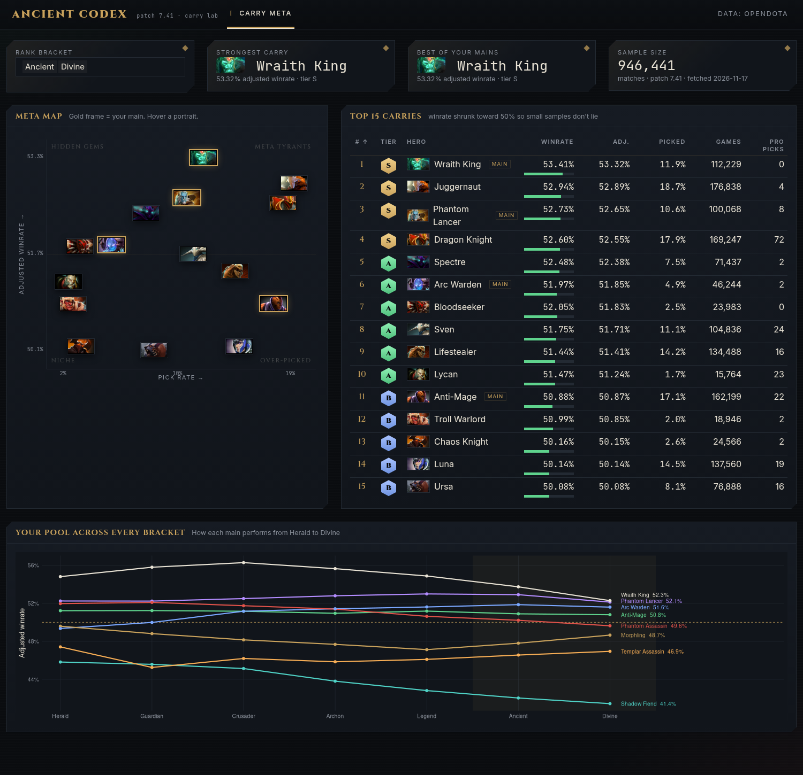

# Dota Carry Lab

_repo: `dota_2_exploration`_

Dota 2 research lab for a **position-1 carry** player (Ancient–Divine), built in **R**:

- 📊 **Shiny dashboard** with a cold, esports-tool dark UI: carry meta board + tier list, hero build pages with item icons, item codex, draft helper and personal stats.
- 🧠 **Knowledge pack** (`knowledge/`): compressed Dota notes + JSON that an LLM agent can load to give fast, patch-aware advice.
- 🔬 **Research write-ups** (`docs/research/`): one analysis per roadmap step, for example the [patch 7.41 carry meta](docs/research/01_carry_meta_7.41.md).

Mains: Anti-Mage · Morphling · Phantom Lancer · Wraith King · Templar Assassin · Shadow Fiend · Arc Warden · Phantom Assassin.



## Quick start
```bash
Rscript install.R                     # install missing R packages (once)
Rscript -e 'shiny::runApp("app")'     # open the dashboard
```
The repo ships with a data snapshot (patch 7.41), so the app works offline. To refresh:
```bash
Rscript scripts/01_fetch_opendota.R   # new OpenDota snapshot (resumable, ~3 min)
Rscript scripts/04_fetch_bracket_matchups.R  # Ancient–Divine matchups via the OpenDota SQL explorer
Rscript scripts/02_build_knowledge.R  # regenerate knowledge/ + data/processed/
Rscript scripts/03_item_efficiency.R  # item gold-efficiency table
```

## Repository layout
```
app/                    Shiny app
  app.R                 entry point: navbar + pages
  R/                    auto-sourced by Shiny
    config.R            settings: hero pool, brackets, paths
    opendota.R          tiny OpenDota API client
    data.R              load snapshot + lookups (icons, builds)
    scoring.R           the math: shrinkage, tiers, matchups (+ TODOs for you)
    theme.R             bslib theme + ggplot theme
    components.R        reusable UI pieces (rune tiles, meta map, item icons)
    mod_*.R             one module per page
  www/styles.css        design system implementation (spec: docs/design/DESIGN_SYSTEM.md)
scripts/                data pipeline (run from repo root)
data/
  raw/opendota/         API snapshot (committed, so the app works offline)
  curated/              hand-written truth: heroes.json, item_notes.json, mechanics.json
  processed/            generated: carry_meta.json, items_reference.json
knowledge/              LLM context pack (see knowledge/README.md)
docs/                   roadmap, research write-ups, screenshots
```

## Roadmap
See [docs/ROADMAP.md](docs/ROADMAP.md). Each step ships a page, a research write-up and focused commits.

## Data & credits
Stats from the free [OpenDota API](https://docs.opendota.com/). Hero and item images are
served from Valve's CDN; Dota 2 is a trademark of Valve Corporation. This is a personal
study project, not affiliated with Valve.
