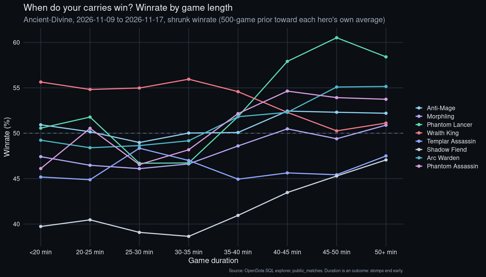

# Research 06 — Power curves: when does each carry win?

_Data: OpenDota SQL explorer (`public_matches`, Ancient+Divine = `avg_rank_tier` 60–79, games ≥ 10 min),
**1,176,151 matches from 2026-11-09 to 2026-11-17** (match_id 9,083,519,267 → 9,093,519,267), patch 7.41.
32-hero carry pool (`CARRY_POOL` + `MY_MAINS`), 12,491 (Naga) to 219,927 (Juggernaut) games per hero.
Item timings from `data/curated/heroes.json` (`core[].target_min`). Machine-readable output:
`data/processed/power_curves.json`. Script: `scripts/05_fetch_power_curves.R`. Sources: `docs/SOURCES.md` (S11, S4, S15)._

## TL;DR
1. **Most of your mains are late-game heroes.** PL (+10.0 pp swing), PA (+6.3), Arc (+5.7), SF (+5.7)
   and Morphling (+4.1) all win more the longer the game goes. Anti-Mage leans late (+2.7) but is
   flatter than his reputation. **Wraith King is the opposite:** he is best before 40 min (−3.7 swing).
   Templar Assassin is flat (−0.5): her short-game edge is not visible in this sample.
2. **Phantom Lancer has the steepest curve of your pool:** 46.7% at 25–35 min, **60.5% at 45–50 min**.
   PL's problem is the middle of the game, not the end. Survive 25–35 min and he is the best late carry you own.
3. **Wraith King is your "fight now" hero.** 55–56% from minute 10 to 35, then down to 50% after 45 min.
   With WK, push the Radiance/Blink/BKB timing (16–25 min) and end. Don't farm for a 6-slot.
4. **Shadow Fiend loses at every length**, but much less in long games (39% before 35 min → 47% at 50+).
   He is a bad hero this patch that becomes "only slightly bad" if the game goes long.
5. **Real early-tempo carries in the pool:** Lycan (+10.6 pp under 30 min, the most extreme curve of all 32),
   Chaos Knight, Terrorblade, Drow. **Mid-game humps:** Sven (56.7% at 30–35), Lifestealer, Bloodseeker.
   **Hardest late scalers:** Medusa, Faceless Void, PL, Alchemist (+10 to +12 pp swing).
6. **Duration is an outcome, not a cause.** A short game is usually a stomp, so "wins early" partly means
   "wins stomps" and "wins late" partly means "doesn't lose fast". Read the curves as *where the hero's wins
   come from*, not as a rule that a game will go a certain way because you picked him (see Caveats).



---

## How to read this

- **Bucket** = the game's final duration: `<20` (10–20 min), `20-25`, … `45-50`, `50+` minutes.
  Games under 10 minutes (0.8% of the bracket: remakes, early abandons) are dropped.
- **Shrunk winrate** = `(wins + 500 × overall) / (games + 500)`: every bucket gets 500 imaginary games
  at the hero's **own** average winrate (the same `shrink()` as `app/R/scoring.R`, with the hero's
  average as baseline instead of 50%). Buckets with 15k+ games barely move. Thin buckets (Naga <20 min:
  650 games) are pulled toward the hero's average.
- **Early index** = pooled shrunk winrate of games under 30 min, minus the hero's overall winrate.
  **Mid index** = 30–40 min. **Late index** = over 40 min. **Swing** = late − early.
- **Curve type** (a reading aid, thresholds in the script):
  *mid-game* if the 30–40 window beats both ends by ≥ 1.5 pp; else *late scaler* if swing ≥ +4 pp;
  *early tempo* if swing ≤ −4 pp; else *flat*.
- **Noise level:** a bucket with 10,000 games has a 95% interval of about ±1 pp; with 2,000 games about ±2.2 pp.
  Differences under ~2 pp between neighbouring buckets are not meaningful.

### How long are Ancient–Divine games?

| Duration | <20 | 20–25 | 25–30 | 30–35 | 35–40 | 40–45 | 45–50 | 50+ |
|---|---|---|---|---|---|---|---|---|
| Share of games | 3.1% | 7.9% | 11.5% | 18.9% | 18.4% | 16.5% | 10.2% | 13.6% |
| Radiant winrate | 59.5% | 55.9% | 56.8% | 54.5% | 52.4% | 49.9% | 49.9% | 49.2% |

Only **22% of games end before 30 min**, and **40% go past 40 min**. The median game lasts about 37 minutes.
So the "late" bucket is not a rare edge case: it is where 4 in 10 of your games are decided. (Side note:
the Radiant advantage is entirely an early-game thing; after 40 min the sides are even.)

---

## Power curve tier list

| Type | Heroes (★ = your main) |
|---|---|
| **Early tempo** (win before 30 min, fade after) | **Lycan** (+10.6 early), **Chaos Knight**, **Terrorblade**, **Drow Ranger** |
| **Leans early** (flat, but best before 35) | **Wraith King ★**, Razor, Slark, Ursa, Dragon Knight, Troll Warlord |
| **Mid-game** (hump at 30–40 min) | **Sven** (peak 56.7% at 30–35), **Lifestealer**, **Bloodseeker** |
| **Flat** (length doesn't matter much) | **Templar Assassin ★**, Juggernaut, Luna, Gyrocopter, Kez |
| **Leans late** (flat, but best after 40) | **Anti-Mage ★**, Weaver, Muerta |
| **Late scalers** (win after 40 min) | **Medusa**, **Faceless Void**, **Phantom Lancer ★**, **Alchemist**, **Phantom Assassin ★**, **Arc Warden ★**, **Shadow Fiend ★**, Spectre, Monkey King, Naga Siren, **Morphling ★** |

Your pool has **5 late scalers, 1 late-leaning, 1 flat, 1 early-leaning**. In a draft that wants to
end the game by 30 minutes, **Wraith King is your only good answer**.

---

## All 32 heroes

Sorted from most "early" to most "late". Indices are percentage points vs the hero's own overall winrate.
"Early / late share" = share of the hero's games that ended before 30 min / after 40 min.

| Hero | Games | Overall WR % | Early (<30) | Mid (30–40) | Late (>40) | Swing | Peak window (WR %) | Early / late share | Type |
|---|---|---|---|---|---|---|---|---|---|
| Lycan | 19,331 | 51.3 | +10.6 | -1.4 | -7.6 | -18.3 | 25-30 (62.4) | 29% / 33% | early tempo |
| Terrorblade | 42,420 | 46.5 | +3.8 | -0.1 | -2.5 | -6.3 | <20 (51.0) | 25% / 37% | early tempo |
| Chaos Knight | 33,760 | 50.8 | +3.0 | +0.5 | -3.0 | -6.0 | <20 (54.0) | 29% / 35% | early tempo |
| Drow Ranger | 142,843 | 46.8 | +3.4 | -1.8 | -1.0 | -4.4 | <20 (53.1) | 29% / 38% | early tempo |
| Sven | 121,310 | 51.5 | +0.5 | +3.7 | -3.6 | -4.1 | 30-35 (56.7) | 19% / 42% | mid-game |
| Razor | 73,030 | 50.0 | +2.3 | +0.5 | -1.7 | -4.0 | 25-30 (53.2) | 22% / 42% | flat |
| **Wraith King ★** | 137,454 | 53.7 | +1.4 | +1.6 | -2.3 | -3.7 | 30-35 (56.0) | 23% / 40% | flat |
| Ursa | 91,993 | 50.2 | +1.5 | +0.5 | -1.2 | -2.7 | 25-30 (52.5) | 21% / 43% | flat |
| Slark | 195,086 | 49.9 | +2.0 | -0.7 | -0.6 | -2.6 | <20 (52.3) | 24% / 39% | flat |
| Dragon Knight | 191,272 | 52.6 | +1.4 | -0.1 | -0.5 | -1.9 | 20-25 (54.5) | 18% / 43% | flat |
| Troll Warlord | 26,836 | 51.0 | +1.0 | +0.1 | -1.0 | -1.9 | 20-25 (52.5) | 29% / 35% | flat |
| Luna | 161,771 | 50.1 | +0.4 | +1.0 | -1.2 | -1.6 | 35-40 (51.4) | 21% / 39% | flat |
| **Templar Assassin ★** | 50,906 | 46.2 | +0.5 | -0.2 | -0.1 | -0.5 | 25-30 (48.4) | 22% / 39% | flat |
| Gyrocopter | 59,922 | 46.9 | -0.1 | +0.6 | -0.5 | -0.4 | 25-30 (48.4) | 22% / 40% | flat |
| Kez | 56,804 | 44.4 | -0.4 | +0.8 | -0.5 | -0.2 | 30-35 (45.4) | 24% / 39% | flat |
| Bloodseeker | 32,266 | 51.0 | -1.9 | +2.4 | -1.0 | +0.9 | 30-35 (53.5) | 24% / 41% | mid-game |
| Juggernaut | 219,927 | 52.8 | -1.1 | +0.7 | +0.0 | +1.1 | 30-35 (53.6) | 24% / 37% | flat |
| Weaver | 58,394 | 47.9 | -0.8 | -0.9 | +1.3 | +2.1 | 50+ (52.1) | 27% / 38% | flat |
| Muerta | 32,593 | 48.2 | -1.3 | -0.3 | +1.2 | +2.5 | 50+ (50.2) | 26% / 39% | flat |
| **Anti-Mage ★** | 191,844 | 50.9 | -1.3 | -0.8 | +1.5 | +2.7 | 40-45 (52.4) | 21% / 40% | flat |
| Lifestealer | 153,523 | 51.4 | -3.3 | +1.7 | -0.1 | +3.2 | 35-40 (53.3) | 18% / 43% | mid-game |
| **Morphling ★** | 50,282 | 48.2 | -1.9 | -0.7 | +2.2 | +4.1 | 50+ (50.9) | 26% / 35% | late scaler |
| Naga Siren | 12,491 | 49.7 | -2.7 | +0.2 | +2.1 | +4.8 | 40-45 (53.9) | 29% / 34% | late scaler |
| Monkey King | 64,532 | 47.0 | -1.7 | -2.3 | +3.4 | +5.1 | 50+ (52.5) | 26% / 38% | late scaler |
| Spectre | 88,894 | 52.7 | -2.8 | -1.5 | +2.4 | +5.2 | 45-50 (56.4) | 20% / 45% | late scaler |
| **Shadow Fiend ★** | 88,329 | 41.8 | -2.2 | -2.1 | +3.5 | +5.7 | 50+ (47.1) | 27% / 38% | late scaler |
| **Arc Warden ★** | 55,912 | 51.5 | -3.0 | -1.0 | +2.6 | +5.7 | 50+ (55.1) | 22% / 40% | late scaler |
| **Phantom Assassin ★** | 121,265 | 50.8 | -2.8 | -0.7 | +3.5 | +6.3 | 40-45 (54.6) | 32% / 33% | late scaler |
| Alchemist | 32,322 | 46.6 | -5.1 | -0.5 | +4.8 | +9.9 | 50+ (53.5) | 29% / 34% | late scaler |
| **Phantom Lancer ★** | 119,059 | 53.1 | -4.3 | -3.9 | +5.8 | +10.0 | 45-50 (60.5) | 21% / 41% | late scaler |
| Faceless Void | 85,503 | 49.3 | -4.9 | -3.0 | +6.3 | +11.2 | 45-50 (56.7) | 27% / 38% | late scaler |
| Medusa | 26,399 | 49.6 | -5.1 | -3.5 | +6.6 | +11.6 | 45-50 (57.5) | 25% / 39% | late scaler |

Average swing across the pool: **+1.0 pp**. The carry pool as a whole leans slightly late, as expected
for position-1 heroes, so "flat" for a carry already means "keeps up with the late game".

---

## Deep-dive: your 8 mains

Shrunk winrate per bucket (raw winrate is within 0.6 pp of these for every main). Item targets are the
curated free-farm timings (`core[].target_min`); add 2–4 minutes for a contested lane.

| Main | <20 | 20–25 | 25–30 | 30–35 | 35–40 | 40–45 | 45–50 | 50+ |
|---|---|---|---|---|---|---|---|---|
| Anti-Mage | 50.9 | 50.2 | 49.0 | 50.0 | 50.1 | **52.4** | 52.3 | 52.2 |
| Morphling | 47.4 | 46.5 | 46.1 | 46.6 | 48.6 | 50.5 | 49.4 | **50.9** |
| Phantom Lancer | 50.6 | 51.8 | 46.7 | 46.7 | 51.8 | 57.9 | **60.5** | 58.4 |
| Wraith King | 55.6 | 54.8 | 55.0 | **56.0** | 54.6 | 52.3 | 50.3 | 51.1 |
| Templar Assassin | 45.2 | 44.9 | **48.4** | 47.0 | 44.9 | 45.6 | 45.4 | 47.5 |
| Shadow Fiend | 39.7 | 40.5 | 39.1 | 38.6 | 40.9 | 43.5 | 45.3 | **47.1** |
| Arc Warden | 49.2 | 48.4 | 48.6 | 49.2 | 51.8 | 52.3 | 55.1 | **55.1** |
| Phantom Assassin | 46.1 | 50.5 | 46.6 | 48.2 | 52.2 | **54.6** | 53.9 | 53.7 |

### Phantom Lancer — late scaler, with a dip at 25–35 min
- **Curve:** 50.6–51.8% early, **46.7% at 25–35**, then 57.9 → 60.5 → 58.4% after 40 min. Swing +10.0 pp.
- **Item timings:** Manta 18, Aghanim's 24, Skadi 30, Heart 34, Butterfly 38. The dip (25–35) is the window
  between Aghs and Skadi/Heart: you have illusions but not yet the stats and survivability that make them lethal.
  The curve turns up right when Heart/Butterfly arrive (35–40 min).
- **When to fight:** early skirmishes with Doppel + Lance are fine (the 20–25 bump is real, 8k games).
  **Avoid committing to big 5v5 fights at 25–35 min**, especially into AoE (R04: Tidehunter, Underlord, Dark Seer, Axe).
  Split-push and farm instead; take the fight after Skadi/Heart.
- **Takeaway:** if your team can stall to 40 min, PL is the strongest hero in your whole pool (60.5% at 45–50).

### Wraith King — early-to-mid, falls off late
- **Curve:** 55–56% from 10 to 35 min, peak **56.0% at 30–35**, then 52.3 → 50.3% after 40 min. Swing −3.7 pp.
- **Item timings:** Radiance 16, Blink 20, Shard 22, BKB 25, Assault 32. All of WK's core lands **inside his peak**.
  After Assault Cuirass (32 min) he has no further big spike, and the late heroes catch up.
- **When to fight:** as soon as Blink + Shard are in (~22 min). Group, take towers, force fights around Roshan.
  **Avoid** farming toward a 6-slot at 35+ min while a PL/Medusa/Void scales: that is the game he loses.
- **Takeaway:** WK is your answer when your draft wants to end by 35 min. Play for the Aegis + high-ground push at 25–35.

### Phantom Assassin — late scaler, with a 20–25 bump
- **Curve:** 46.1% under 20, **50.5% at 20–25**, dip to 46.6% at 25–30, then up to **54.6% at 40–45**. Swing +6.3 pp.
- **Item timings:** Battle Fury 15 *or* Desolator 19, BKB 23, Abyssal 29, Satanic 33. The 20–25 bump matches the
  Desolator/BKB window: a fast Deso PA can win fights there. The real climb starts after Abyssal + Satanic (30–35).
- **When to fight:** pick off supports at 20–25 with Deso + BKB. Avoid long, drawn-out 5v5 at 25–30 (that dip).
  From 35 min on, take every fight you can start with Abyssal on a core.
- **Note:** PA has the highest share of short games among your mains (32% under 30 min), and she loses most of
  them. When PA's game is decided early, it is usually against her.

### Arc Warden — late scaler, smooth climb
- **Curve:** 48–49% until 35 min, then 51.8 → 52.3 → **55.1%** at 45+. Swing +5.7 pp. No dip, just a slow climb.
- **Item timings:** Maelstrom 14, BoT 19, Mjollnir 22, Bloodthorn 28, Hex 32. His items come early, but his winrate
  does not jump until 35+ min. That fits Arc's real win condition: double-hero split-push wears the enemy down over time.
- **When to fight:** don't force fights before 35 min. Push two lanes with Tempest Double and make them answer.
  Fight only when it's a pick-off or when they come to you.
- **Takeaway:** Arc is a patient hero. If your team needs a hero to take fights at 25 min, Arc is the wrong pick.

### Shadow Fiend — bad at every length, least bad late
- **Curve:** ~39–40% until 35 min, then 43.5 → 45.3 → **47.1%** at 50+. Swing +5.7 pp, overall 41.8%.
- **Item timings:** Dragon Lance 13, Manta 19, BKB 23, Daedalus 28, Satanic 33. The curve only moves after Satanic (35+).
- **When to fight:** with SF, avoid fights you can't win with one Requiem from fog. Farm and wait for a 6-slot.
- **Takeaway:** SF never reaches 50% in any bucket. The long-game climb is real, but it's not enough. Pick him only
  if you are practising him on purpose (R04 found the same 41.8% overall).

### Morphling — late scaler (mild)
- **Curve:** 46–47% until 35 min, 48.6 at 35–40, about **50–51%** after 40. Swing +4.1 pp.
- **Item timings:** Manta 19, Dragon Lance 22, Butterfly 29, BKB 31, Satanic 35. The climb starts after BKB + Satanic,
  which are the items that let Morph stay in a fight (shift-sustain through Satanic).
- **When to fight:** early lane kills with Waveform + Adaptive Strike are fine, but don't commit to 5v5 before BKB.
- **Takeaway:** Morph is below 50% until 40 min. Pick him when your team can protect a long game.

### Anti-Mage — flat, leans late
- **Curve:** 49–51% until 40 min, **52.2–52.4%** after 40. Swing +2.7 pp, the flattest late carry you have.
- **Item timings:** Battle Fury 15, Manta 21, Abyssal 29, Skadi 31, Butterfly 36. The step up comes after Skadi/Butterfly.
- **When to fight:** AM doesn't lose much by fighting early (he is ~50% at every length), but he gains most by
  split-pushing until 4–5 items. Avoid big fights before Manta + Abyssal.
- **Takeaway:** AM is more "always okay" than "late-game monster" in this bracket. He's a safe pick when you don't
  know how long the game will be.

### Templar Assassin — flat (as a carry)
- **Curve:** 45% under 25, **48.4% at 25–30**, 45–47% after. Swing −0.5 pp, overall 46.2%.
- **Item timings:** Desolator 14, Blink 18, BKB 24, Daedalus 28, Hurricane Pike 32. The only small peak (25–30)
  lines up with BKB + Daedalus.
- **When to fight:** 24–30 min (BKB + crit) is TA's best window. Plan your Roshan/high-ground push there.
- **Caveat:** most TA games in pubs are **mid** TA, and there is no position column. The "TA ends games early"
  idea does not show up here: her early buckets are her weakest. Treat this curve with extra care.

---

## Practical draft advice

1. **Your team is early-game** (lane dominators, Lycan, CK, gankers, push heroes): pick **Wraith King**. He is
   the only main whose peak (10–35 min) matches a team that wants to end by 30–35.
   Outside your pool, Lycan, Chaos Knight and Sven fit too.
2. **Your team is late-game or defensive** (wave clear, save spells, high-ground defence): pick **Phantom Lancer**
   (60% at 45–50) or **Arc Warden** (55% at 45+). They pay off the stall.
3. **You don't know yet / you're first pick:** **Anti-Mage** (flat ~50–52%) or **WK** (high overall, 53.7%).
   Avoid committing to a hero with a deep mid-game dip (PL, PA) before you see the enemy draft.
4. **The enemy has early tempo** (Lycan, CK, Terrorblade, Drow, or a strong early mid): your late scalers must
   **survive 25–35 min**. Pick PL/Arc only if your supports and offlaner can defend towers; otherwise WK.
5. **The enemy has hard late scalers** (Medusa, Void, PL, Alchemist): you need to **end before 40 min**. WK, or a
   tempo carry, is the right answer. A slow AM/Morph game vs Medusa is the game they want.
6. **Match your farm plan to the curve.** For a late scaler, a game where you are behind at 25 min is not lost:
   PL, PA, Arc and SF all gain 5–10 pp after 40. For WK, a game that drifts past 40 is getting *worse* every minute.

---

## Caveats

- **Duration is an outcome, not a cause.** Games end early because one side stomps. A hero with a high
  "under 25 min" winrate is a hero that tends to be on the stomping side (strong lane, snowball), and a hero with
  a low one is a hero that gets stomped when his lane fails. "Late winrate" mixes "really strong late" with
  "the game went late *because* this hero didn't lose early". The curve tells you where a hero's wins come from;
  it does not promise that picking him will make the game go long.
- **Selection effects.** Who plays each hero, and into what draft, changes with game length. Late buckets are
  full of games where the late hero's team *chose* to drag the game out. Players who pick PL in Ancient–Divine are
  likely PL specialists, which inflates his whole curve.
- **No positions.** `public_matches` only has the 5 hero ids per team. A mid TA or mid SF counts the same as a
  pos-1 one. This affects TA, SF, Arc (often mid), and to a lesser degree DK, Razor, Lycan.
- **Lobby average rank.** `avg_rank_tier` 60–79 is the lobby average; some players are outside Ancient–Divine.
- **One week ≠ whole patch.** 2026-11-09 → 2026-11-17 only. Re-run the script after a balance patch.
- **Noise.** Small buckets (Naga, Lycan, Medusa under 20 min: 650–1,000 games) are shrunk but still noisy
  (±3–4 pp). The labels for heroes with |swing| below ~4 pp (flat) can flip with another week of data.
- **Bucket edges.** "Late index" (>40 min) pools 40–45, 45–50 and 50+. 50+ includes games of 60–80 minutes,
  which are rare and chaotic (buybacks, mega creeps).

## Reproduce

```
Rscript scripts/05_fetch_power_curves.R          # 10M match-id window (~1 week), resumable
Rscript scripts/05_fetch_power_curves.R 3e6      # smaller window if the explorer times out
Rscript scripts/05_fetch_power_curves.R --fresh  # delete the raw files and fetch again
```

The run on 2026-11-17 took 34 requests (1 `/publicMatches`, 1 baseline query, 32 hero queries), each query
≈4 s, no timeouts. The SQL is written out in the script. Raw results: `data/raw/opendota/power_curves/`.
